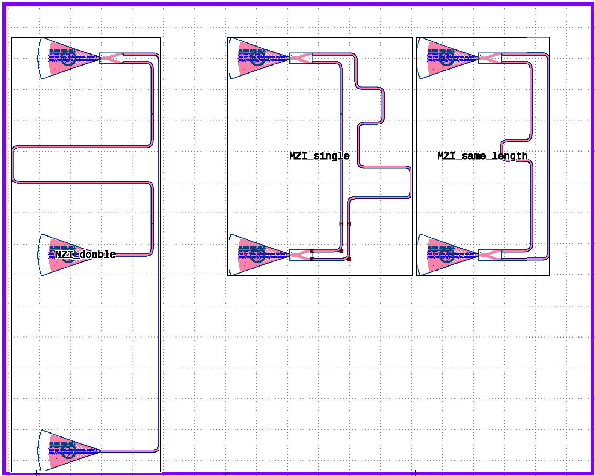
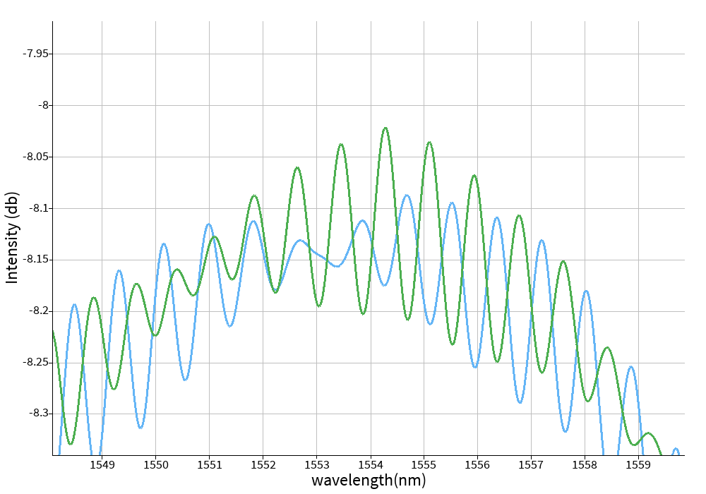
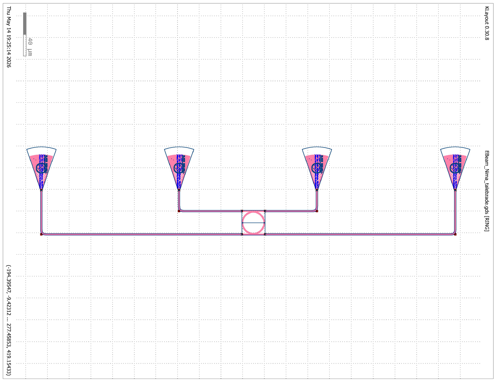
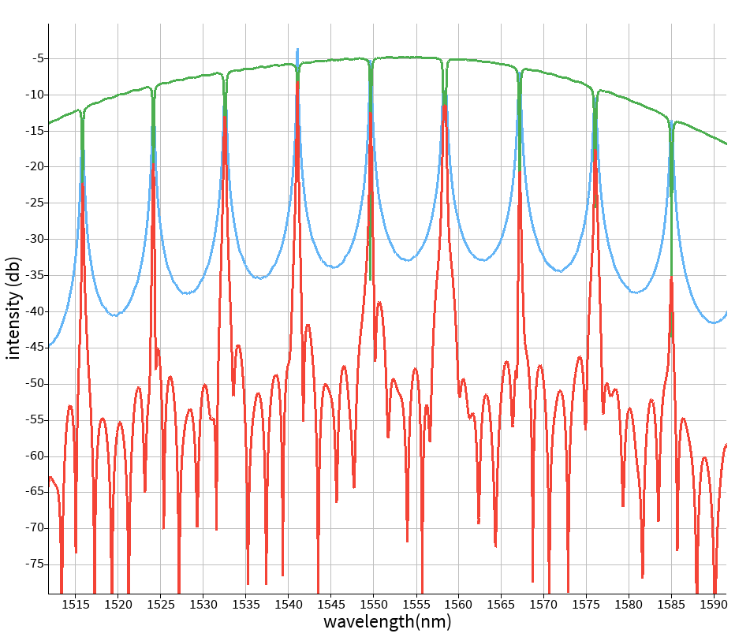
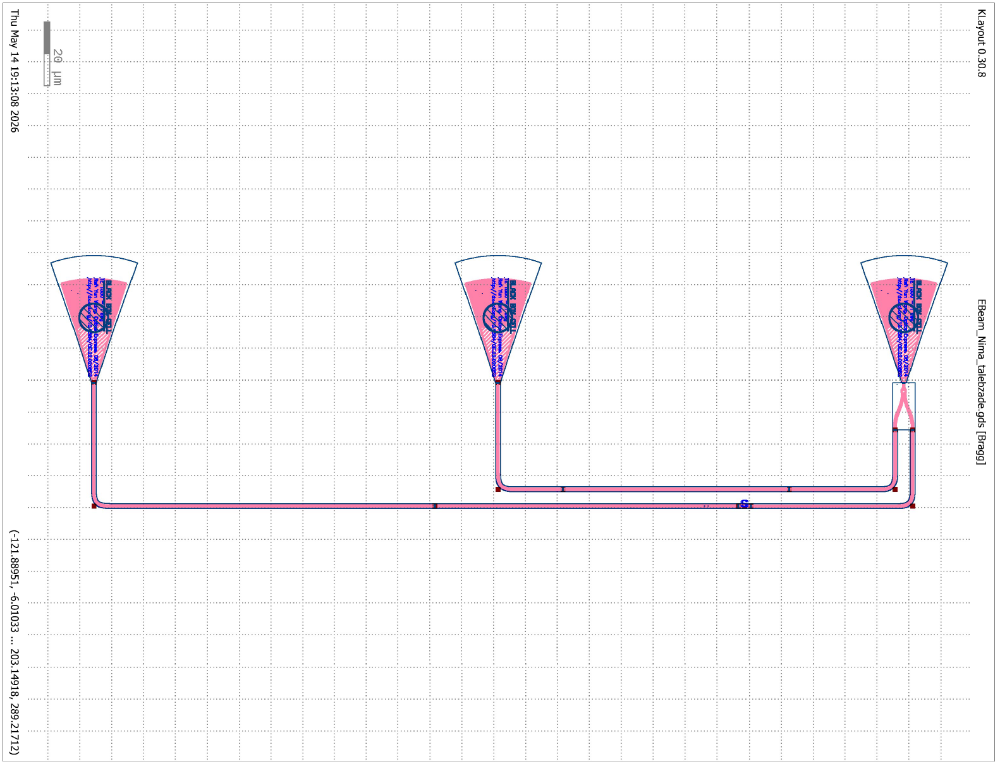
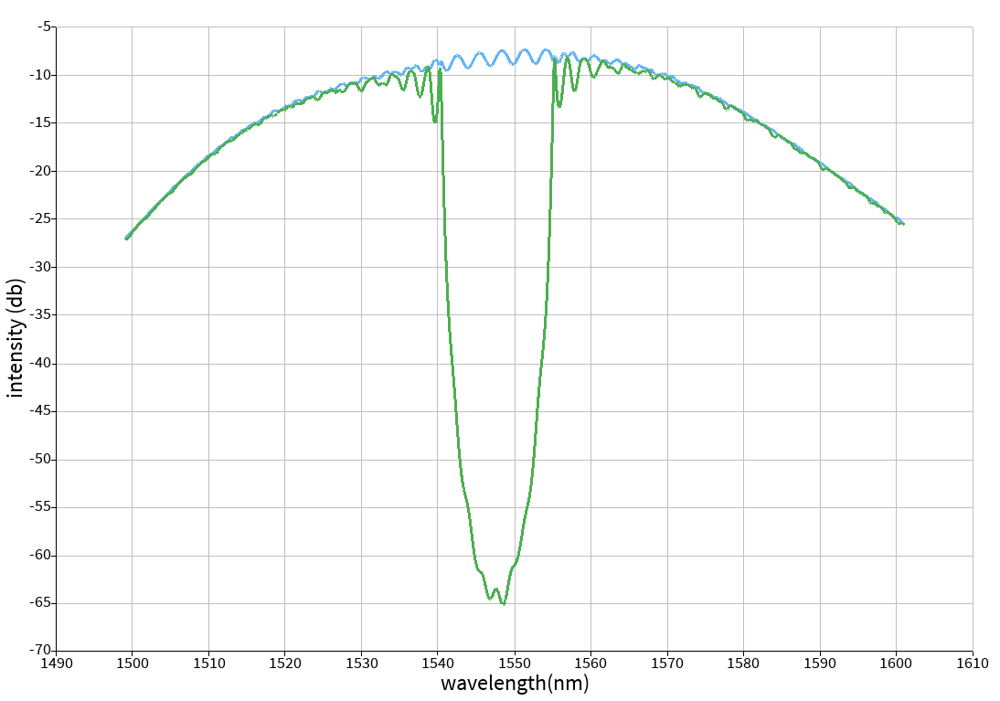
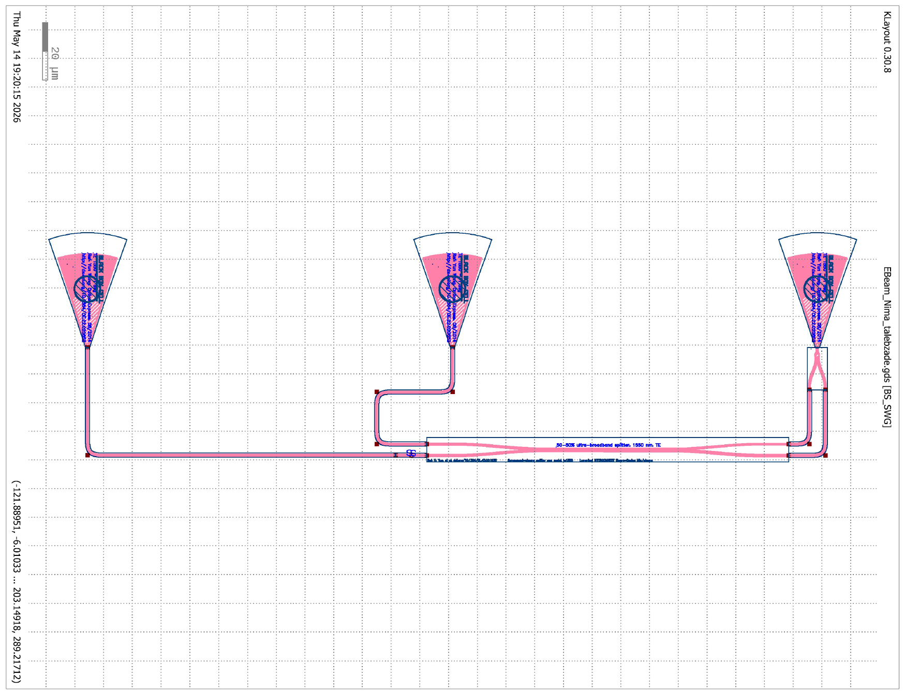
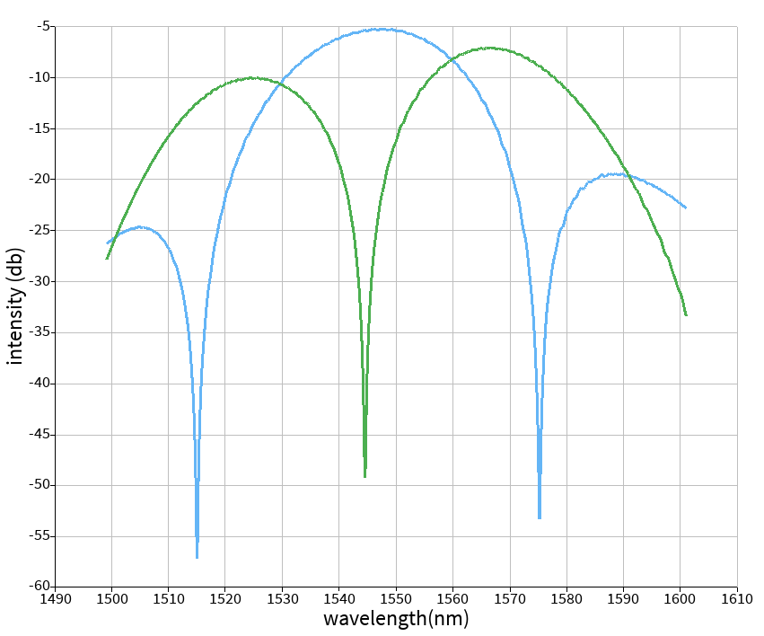

# Silicon Photonics: Passive PIC Design, Simulation & Characterization

**A device-focused photonic integrated circuit (PIC) portfolio** covering Mach–Zehnder interferometers (MZIs), microring resonators, Bragg reflectors, and ultra-broadband optical splitters.

This repository retains the **original KLayout layout figures and Ansys Lumerical simulation plots** and documents the subsequent university-led tapeout, fabrication, and optical characterization workflow. **Simulated results and measured results are treated separately.**

> **Scope:** This repository covers *passive PICs*. The separately submitted 1×4 optical phased array (OPA) is intentionally **not included** and is maintained as a separate project.

## At a glance

| Device | Original design and simulation evidence | Experimental status / metric |
| --- | --- | --- |
| [Mach–Zehnder interferometers](MZI/) | KLayout layout variants and Lumerical spectral simulations | University-led fabrication/characterization; **FSR ≈ 1.5 nm**, preliminary value reported from measured spectra |
| [Microring resonator](Ring-Resonator/) | KLayout layout and simulated response | University-led fabrication/characterization; **FSR ≈ 4.5 nm**, preliminary value reported from measured spectra |
| [Bragg reflector](Bragg-Grating/) | KLayout layout and simulated reflection plot | Fabrication and characterization reported; quantitative measured metrics not yet archived here |
| [Ultra-broadband splitter](Ultra-broadband-splitter/) | KLayout layout and simulated optical response | Fabrication and characterization reported; measured splitting-ratio/bandwidth data not yet archived here |

**Measurement caveat:** The two approximate FSR figures above are author-reported estimates; they have **not** been recomputed from raw CSVs in this repository. They are **not** simulation-to-measurement error percentages or evidence of improved performance versus a benchmark.

## Design, simulation, and measurement workflow

1. **Circuit/device design:** passive PIC architectures and dimensional variants.
2. **Optical modeling:** spectral-response and waveguide/device simulations in **Ansys Lumerical**.
3. **Physical layout:** mask-layout development and inspection using **KLayout**.
4. **Verification:** PDK-based **DRC and LVS** checks completed through a university-led design workflow (reported by the author; verification logs are not included yet).
5. **Tapeout and fabrication:** designs submitted in the university-led fabrication process; passive structures were fabricated.
6. **Optical characterization:** measured transmission responses were obtained through the university workflow; figures and raw experimental datasets are to be archived here once curated and cleared for sharing.
7. **Comparison:** use the same device configuration and spectral window to compare simulation and measurement; avoid claiming numerical agreement until it is evaluated.

See [Characterization & verification notes](docs/CHARACTERIZATION_AND_VERIFICATION.md) for what is verified from repository files, what has been reported, and what remains to be documented.

## Device gallery — original simulation results retained

### 1. Mach–Zehnder interferometers

| KLayout layout | Lumerical simulated transmission |
| --- | --- |
|  |  |

The repository retains three MZI simulation plots plus several layout views. The existing [design notes](MZI/notes/MZI_notes.txt) specify a nominal **1550 nm** operating wavelength and **500 nm** waveguide width. See the [MZI project notes](MZI/README.md).

### 2. Microring resonator

| KLayout layout | Simulated optical response |
| --- | --- |
|  |  |

The measured microring trace discussed separately exhibits unusual closely spaced resonance features; **no Q factor is claimed** here without a validated linewidth fit. See [ring project notes](Ring-Resonator/README.md).

### 3. Bragg reflector

| KLayout layout | Simulated reflection |
| --- | --- |
|  |  |

See [Bragg project notes](Bragg-Grating/README.md).

### 4. Ultra-broadband optical splitter

| KLayout layout | Simulated optical response |
| --- | --- |
|  |  |

See [splitter project notes](Ultra-broadband-splitter/README.md).

## Repository contents

```text
Bragg-Grating/
  layout/                  # KLayout PNG/PDF figures
  simulations/             # Original simulated reflection
MZI/
  layout/                  # KLayout PNG/PDF figures
  notes/                   # Original MZI design notes
  simulations/             # Original simulated spectra
Ring-Resonator/
  layout/                  # KLayout PNG/PDF figures
  simulations/             # Original simulated response
Ultra-broadband-splitter/
  layout/                  # KLayout PNG/PDF figures
  simulation/              # Original simulated response
docs/
  CHARACTERIZATION_AND_VERIFICATION.md
README.md
```

**Existing source-material policy:** Simulation PNGs, layout PNGs, and PDF exports have **not been deleted, renamed, or replaced**. Some layout PDFs are duplicated in the legacy `Screenshot/` directory; they have also been left untouched. A legacy `main.m` is nearly empty and is **not** presented as a functional solver.

## Reproducibility and limitations

- This snapshot primarily contains **figures and layout exports**, not editable GDSII files, Lumerical project files, mask-rule reports, or raw optical-measurement CSVs.
- Figures alone cannot establish insertion loss, extinction ratio, intrinsic/loaded Q, fabrication yield, or simulation–experiment error; those metrics require identifiable experimental datasets and appropriate reference structures.
- Fabrication and measurement were performed through a **university-led workflow**; this description does not imply that the author personally performed each measurement.
- Add new data only where it can be shared publicly and attribution/permission requirements are satisfied.

## Author

**Nima Talebzadeh, Ph.D.** — Photonics, electromagnetic simulation, integrated optical-device design, and optical engineering.

---

*Portfolio documentation refreshed October 2026. Original simulation and layout artifacts are preserved.*
