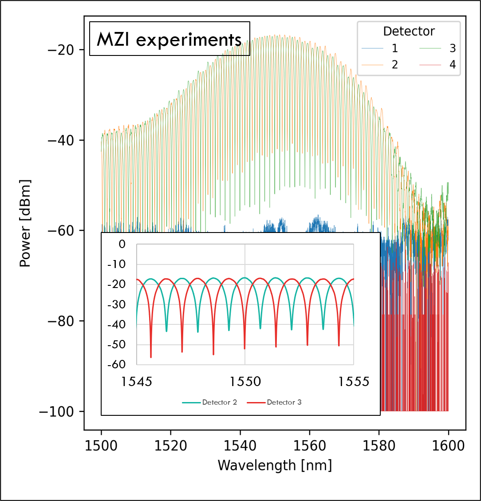
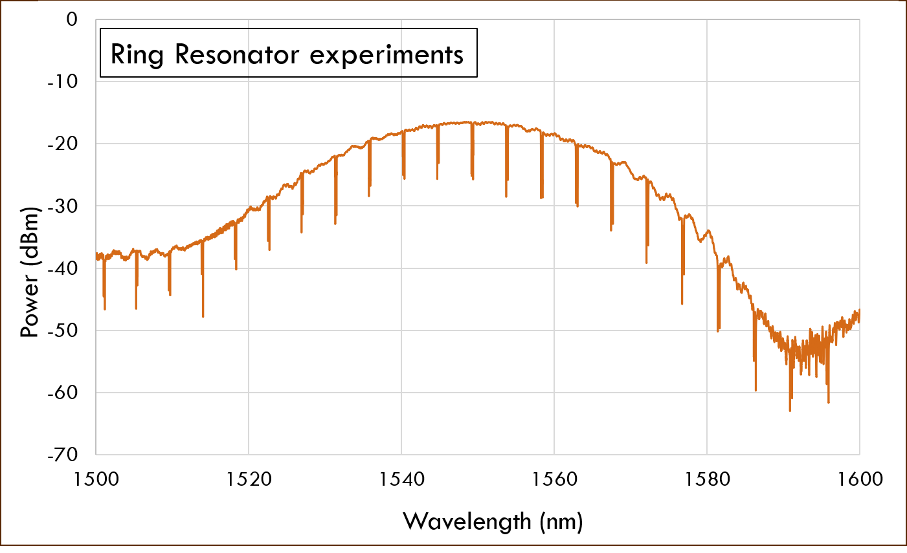
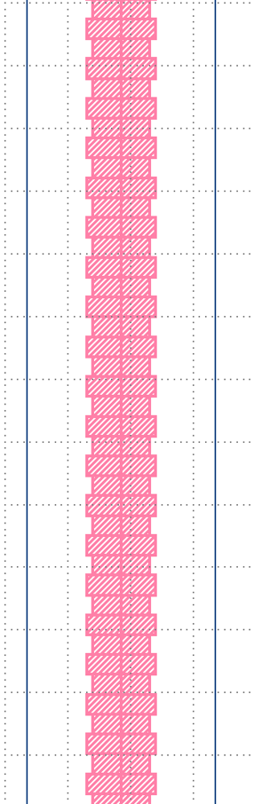
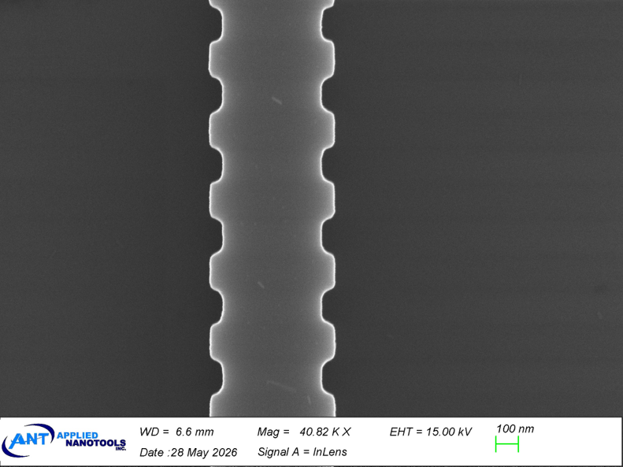

# Silicon Photonics — PIC Design, Simulation & Characterization

Design-to-fabrication portfolio of **passive silicon photonic integrated circuits**: Mach–Zehnder interferometers (MZIs), microring resonators, Bragg reflectors, and ultra-broadband splitters. Projects combine **Ansys Lumerical simulations, KLayout/PDK-based GDSII layouts, DRC/LVS verification, university-led fabrication, and optical characterization**.

**Measured spectral results:** MZI **FSR ≈ 1.5 nm**; microring resonator **FSR ≈ 4.5 nm** (approximate values from measured spectra).

## Projects

### 1 · [Mach–Zehnder Interferometers (MZI)](MZI/)

Several MZI path-length architectures were designed and simulated. Fabricated devices were characterized through wavelength-dependent transmission measurements.

| KLayout layout | Optical simulation | Experimental transmission |
|:---:|:---:|:---:|
|  |  |  |

**Experimental FSR:** approximately **1.5 nm**. Additional [simulation plots](MZI/simulations/) and [layout PDFs](MZI/layout/) are preserved.

### 2 · [Microring Resonator](Ring-Resonator/)

A bus-waveguide-coupled microring was designed, simulated, fabricated, and spectrally characterized.

| KLayout layout | Optical simulation | Experimental transmission |
|:---:|:---:|:---:|
|  |  |  |

**Experimental FSR:** approximately **4.5 nm**. The measured response includes narrow resonance features; a quantitative Q factor is not reported here.

### 3 · [Bragg Reflector](Bragg-Grating/)

Periodic grating structure designed and analyzed for wavelength-selective reflection.

| KLayout layout | Optical simulation | SEM of fabricated grating |
|:---:|:---:|:---:|
|  |  |  |

SEM image: **Applied NanoTools**, 28 May 2026; 100 nm scale bar. The original [KLayout layout](Bragg-Grating/layout/Bragg_reflector_layout_klayout.png) and other figures remain available.

### 4 · [Ultra-Broadband Optical Splitter](Ultra-broadband-splitter/)

Passive broadband power-splitting design and wavelength-response simulation.

| KLayout layout | Optical simulation |
|:---:|:---:|
|  |  |

## Design workflow & tools

**PIC architecture → optical simulation → KLayout/GDSII → PDK verification (DRC/LVS) → university-led tapeout/fabrication → experimental spectral characterization.**

**Tools:** KLayout · Ansys Lumerical · SiEPIC EBeam PDK · GDSII · DRC/LVS.

**Contribution:** PIC design, simulation, layout, and analysis. Device fabrication and experimental characterization were performed through the university workflow. Original simulation results and layout exports are retained in their respective project folders.

**Author:** Nima Talebzadeh, Ph.D.
